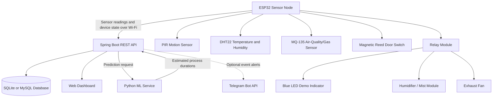

# Automated-Operation-Theatre-Sterilization-System-
Automated Operation Theatre Sterilization System Using IoT, AI/ML, ESP32, and Spring Boot
An academic IoT and machine-learning prototype designed to monitor an operation-theatre-like environment and coordinate a demo sterilization workflow. The system combines an ESP32 sensor node, a Java Spring Boot backend and dashboard, a database, and a Python ML service that estimates the durations of different process stages.
Important safety notice: This repository describes an educational prototype, not a validated medical sterilization system. It must not be used to sterilize a real operating theatre or to make clinical safety decisions. The demo uses a blue LED as a visual indicator; it is not a substitute for germicidal UV-C equipment or a validated sterilization process. Keep hardware interlocks and emergency-stop behavior independent of AI predictions, the web dashboard, Wi-Fi, and Telegram/internet connectivity.

Table of Contents
- Project Overview
- Objectives
- System Architecture
- Main Features
- Hardware Components
- Technology Stack
- Operating Workflow
- Machine Learning
- Model Evaluation Metrics
- Getting Started
- Configuration
- Telegram Notifications
- Safety, Reliability, and Limitations
- Suggested Repository Structure
- Future Improvements
- Contributing
Project Overview
Manual preparation and environmental checks can be time-consuming. This project explores how sensor data, embedded control, a dashboard, and regression models can be combined to demonstrate a more automated workflow.

The ESP32 collects readings from connected sensors and reports them to the backend over Wi-Fi. Spring Boot manages application APIs and dashboard data, while a Python service can load trained regression models and estimate process durations. The application can store sensor readings, estimates, device state, and events in a database.

The hardware workflow is intended for a controlled demonstration only. For example, a blue LED can indicate the phase that would be represented by a sterilization output in a prototype. A humidifier and fan may be used to demonstrate other process stages, subject to the actual hardware setup and safety controls.
Objectives
- Monitor environmental and occupancy-related signals using an ESP32 and sensors.
- Demonstrate a controlled, staged process using relays and low-risk demonstration hardware.
- Expose device state and sensor data through a Java Spring Boot backend and web dashboard.
- Use Python regression models to estimate UV-stage, fog-stage, and fan-stage durations.
- Record relevant readings, estimates, and process events for evaluation.
- Explore optional remote notifications for important state changes.
System Architecture
The following diagram shows the intended high-level architecture. Adapt component names to match the services and modules in your repository.

Main responsibilities
Component	Responsibility
ESP32	Reads connected sensors, communicates device state, and operates supported demo outputs according to firmware logic.
Spring Boot backend	Provides REST APIs, processes incoming device data, coordinates application state, and serves dashboard data.
Web dashboard	Displays current readings, device status, process information, and relevant events.
Python ML service	Loads trained regression models and estimates the durations of configured process stages.
SQLite/MySQL	Stores readings, events, predictions, or other application data as implemented in the selected configuration.
Telegram (optional)	Sends remote messages for configured events when the integration is enabled and connectivity is available.

Main Features
Feature availability depends on which modules are enabled in the current checkout.
- IoT sensing: collect motion, temperature/humidity, air-quality/gas, and door-state signals using the configured sensors.
- Device monitoring: expose the ESP32's reported status and last-seen information where supported.
- Backend API: use Spring Boot REST endpoints to move data between the device, database, dashboard, and ML service.
- Dashboard: view sensor readings and application/device status through a browser.
- ML duration prediction: compare several regression algorithms and save selected trained models for later inference.
- Persistence: store data in SQLite or MySQL, depending on project configuration.
- Optional notifications: Telegram event notifications can be enabled if TelegramNotificationService or an equivalent integration is present and configured.
Hardware Components
The prototype's planned/used components include:
Component	Purpose
ESP32 development board (IoT 03 / ESP32 Dev Board)	Main embedded controller and Wi-Fi communication.
HC-SR501 PIR sensor	Motion/occupancy indication. It does not guarantee that a room is empty.
DHT22 / AM2302	Temperature and relative-humidity readings.
MQ-135 gas/air-quality sensor	Relative gas/air-quality signal for experimentation; readings require calibration and are not a certified air-quality measurement.
MC-38 magnetic reed switch	Door open/closed state indication.
Relay module	Switching compatible demo loads. Verify voltage, current, isolation, and wiring before use.
Blue LED	Visual indicator used in the demo instead of a UV-C source.
Piezoelectric humidifier plate / mist module	Demonstrates a fog or mist stage when safely configured.
Exhaust fan	Demonstrates a ventilation/fan stage.
Suitable regulated power supplies and wiring	Power the controller and peripherals according to their specifications.

Check the exact board, sensor modules, relay ratings, pin assignments, and supply requirements against your hardware before wiring. Do not power high-current loads directly from ESP32 GPIO pins.

Technology Stack
Layer	Technology
Embedded firmware	ESP32; Arduino IDE / compatible ESP32 toolchain
Backend	Java 17+ and Spring Boot (use the version declared in the project build file)
API	REST over HTTP/HTTPS with JSON payloads
ML service	Python and scikit-learn-compatible regression models (confirm exact dependencies in the Python environment files)
Database	SQLite or MySQL, according to configuration
Dashboard	Existing web UI served by or connected to the Spring Boot application
Model serialization	Joblib files, as used by the model-training notebook/code
Optional alerts	Telegram Bot API over HTTPS

Operating Workflow
1. Start and connect: power the ESP32 and connect it to the configured Wi-Fi network.
2. Collect readings: sample the connected PIR, DHT22, MQ-135, and reed-switch inputs according to the firmware implementation.
3. Send telemetry: report available readings and device state to the Spring Boot backend using the configured API/message format.
4. Validate state: backend and firmware logic evaluate supported conditions, such as door status and motion signals. Sensor readings alone must not be treated as proof that a room is safe or empty.
5. Estimate durations: the backend can request predictions from the Python ML service for the configured duration targets.
6. Demonstrate process stages: supported outputs may indicate UV, fog, and fan stages using the configured demo hardware.
7. Record results: save relevant measurements, estimated durations, state changes, and events when persistence is enabled.
8. View and notify: use the dashboard to review status and, if configured, receive Telegram notifications for selected events.
The precise order and safety conditions must follow the code and hardware actually present in the repository. Do not assume a process stage has completed merely because a duration prediction has elapsed.
Machine Learning
The notebook results provided for this project compare the following regression algorithms for three duration targets:
- Estimated_UV_Time_sec
- Estimated_Fog_Time_sec
- Estimated_Fan_Time_sec
Algorithms compared:
- Extra Trees Regressor
- Random Forest Regressor
- Decision Tree Regressor
- Linear Regression
- XGBoost Regressor
- Gradient Boosting Regressor
The initial comparison selected Extra Trees as the highest-R² model for each target. The following values are transcribed from that comparison; they should be treated as notebook evaluation results, not as a guarantee of real-world performance.
Target	Selected model	MAE (s)	RMSE (s)	R²	MAPE (%)
Estimated_UV_Time_sec	Extra Trees	0.064227	0.137561	0.998871	0.264514
Estimated_Fog_Time_sec	Extra Trees	0.063292	0.139801	0.998881	0.330245
Estimated_Fan_Time_sec	Extra Trees	0.207138	0.269089	0.993532	0.843378

The shown training workflow saves selected models to files similar to:
models/
├── uv_duration_model.joblib
├── fog_duration_model.joblib
└── fan_duration_model.joblib
Exact filenames may differ in your current repository. Keep the model input-feature order, preprocessing steps, target units, and training configuration consistent between training and inference.
Important validation note
A separate deployment-results table in the notebook showed much lower R² for UV and fan duration (approximately 0.391 and 0.583, respectively), while fog duration remained strong. This discrepancy needs investigation before deployment. Potential causes include different train/test distributions, preprocessing or feature mismatches, leakage in the earlier evaluation, or a dataset shift. These are possible explanations, not established causes.

Before using the predictions, evaluate the saved model on a held-out dataset representative of the intended operating conditions. Report the split strategy, sample count, feature list, target range, and metrics for both validation and deployment data. Do not claim that these scores establish sterilization effectiveness.
Model Evaluation Metrics
The notebook uses four regression metrics:
Mean Absolute Error (MAE)
Average absolute difference between the actual target and the predicted target. Its units match the target, in this case seconds. Lower is better.
\[
MAE = \frac{1}{n}\sum_{i=1}^{n}|y_i-\hat{y}_i|
\]
Root Mean Squared Error (RMSE)
Square root of the mean squared prediction error. It uses the target's units and penalizes large errors more heavily than MAE. Lower is better.
\[
RMSE = \sqrt{\frac{1}{n}\sum_{i=1}^{n}(y_i-\hat{y}_i)^2}
\]
Coefficient of Determination (R²)
Compares the model's squared prediction errors with the variation around the mean target value. A value of 1 indicates a perfect fit on the evaluated samples; 0 corresponds to the mean-prediction baseline; negative values can indicate worse performance than that baseline. Higher is generally better.
\[
R^2 = 1 - \frac{\sum_i (y_i-\hat{y}_i)^2}{\sum_i (y_i-\bar{y})^2}
\]
Mean Absolute Percentage Error (MAPE)
Average absolute error expressed relative to each actual value, normally as a percentage. Lower is better, but MAPE can be misleading when actual values are zero or very close to zero. Check how the notebook handles zero values and whether it multiplies the result by 100.
\[
MAPE = \frac{100}{n}\sum_{i=1}^{n}\left|\frac{y_i-\hat{y}_i}{y_i}\right|
\]
Getting Started
Because exact paths and start commands depend on the current repository layout, first inspect the root directory and follow the existing README, build files, environment files, and firmware configuration. The steps below are a general setup guide; update paths and commands to match the code in this repository.
Prerequisites
- Git
- Java version compatible with the project's Spring Boot build (Java 17 is the intended baseline if the project is configured for it)
- Maven or Gradle, according to the backend build file
- Python version and packages required by the ML service
- Arduino IDE or the configured ESP32 toolchain
- SQLite or MySQL if required by the selected database configuration
- A local Wi-Fi network accessible to the ESP32 and backend
1. Clone the repository
git clone <YOUR_GITHUB_REPOSITORY_URL>
cd <YOUR_REPOSITORY_DIRECTORY>
Replace the placeholders with your actual GitHub URL and repository directory.
2. Configure the backend
Inspect pom.xml or build.gradle and use the matching build tool. For a Maven Spring Boot project, a typical command is:
./mvnw spring-boot:run
On Windows Command Prompt or PowerShell, use mvnw.cmd spring-boot:run if the wrapper is present. If the repository does not include the Maven wrapper, use the installed Maven command supported by the project.
3. Configure the Python ML service
Use the Python version and dependencies specified by the repository. A typical virtual-environment workflow is:
python -m venv .venv
Activate the environment, then install the dependencies from the repository's requirements file if one exists:
# Windows PowerShell
.\.venv\Scripts\Activate.ps1
pip install -r requirements.txt
Start the ML service using the entry point documented in its directory. Ensure the backend's configured ML-service URL and the service's listening port match. Do not guess endpoint paths or ports—check the source/configuration.
4. Configure and upload ESP32 firmware
1. Open the firmware project in Arduino IDE or the tool specified by the repository.
2. Install the required ESP32 board package and libraries listed by the firmware.
3. Set the correct board and serial port.
4. Configure Wi-Fi and backend connection settings using the project's existing configuration mechanism.
5. Verify sensor pins, voltage requirements, and relay compatibility before connecting hardware.
6. Upload and inspect serial output to confirm initialization and connectivity.
Do not store Telegram credentials in ESP32 firmware. Telegram communication belongs in the backend.
5. Start and verify the application
Start the backend, ML service, and frontend/firmware components according to the repository's run instructions. Verify one component at a time:
- The backend starts without configuration errors.
- The ESP32 reports its expected online state, if that feature exists.
- Sensor readings are received and displayed correctly.
- The backend can contact the ML service, if predictions are enabled.
- Model files load successfully and the input-feature order matches training.
- The dashboard reports actual backend/device state rather than fixed sample values.
Configuration
Use the repository's existing configuration conventions. Keep credentials and machine-specific settings outside version control.

For example, the backend may support environment variables for application configuration and optional Telegram notifications. Only use settings implemented by your current code.

Example placeholder environment variables for Telegram, if that integration is present:
TELEGRAM_BOT_ENABLED=true
TELEGRAM_BOT_TOKEN=<set-your-token-locally>
TELEGRAM_BOT_CHAT_ID=<set-your-chat-id-locally>
TELEGRAM_BOT_API_URL=https://api.telegram.org
For a Spring Boot application.properties file, an environment-based configuration can look like this:
telegram.bot.enabled=${TELEGRAM_BOT_ENABLED:true}
telegram.bot.token=${TELEGRAM_BOT_TOKEN:}
telegram.bot.chat-id=${TELEGRAM_BOT_CHAT_ID:}
telegram.bot.api-url=${TELEGRAM_BOT_API_URL:https://api.telegram.org}
These properties have an effect only if the application code binds to and uses them. Do not commit a real bot token or chat ID. If a token has been exposed, revoke it with BotFather and replace it.
Telegram Notifications
Telegram is an optional remote-notification channel if implemented and enabled in the current version. A typical setup is:
1. Create a bot using @BotFather.
2. Open the new bot in Telegram and send /start.
3. Obtain the destination chat ID using a secure, local workflow.
4. Configure TELEGRAM_BOT_TOKEN and TELEGRAM_BOT_CHAT_ID on the backend host.
5. Enable the integration and send a test notification from the application if a protected test feature is available.
6. Trigger a safe test event and verify the message, event history, and backend logs.
Possible notification categories include door-state changes during an active cycle, reported motion/occupancy events, device-offline alerts, sensor faults, emergency-stop activation, cycle completion, and ML-service unavailability. Only enable categories that the actual system detects and handles.

Notification messages are not safety controls. Telegram requires network connectivity and cannot guarantee immediate receipt or that a user has read the message. The local system must remain safe if Telegram is disabled, offline, or misconfigured. Do not add Telegram commands that directly operate relays or other actuators.
Safety, Reliability, and Limitations
- Prototype only: not validated or certified for clinical use, infection control, or real operating-theatre sterilization.
- Blue LED demo: does not produce the germicidal effect of UV-C and must not be presented as actual sterilization.
- No occupancy guarantee: a PIR sensor may miss stationary people or be affected by environmental conditions. Never use it alone to prove an area is empty.
- Sensor calibration: DHT22 and MQ-135 readings depend on hardware, placement, calibration, warm-up, and environment. The MQ-135 is not a certified medical or safety instrument.
- Physical safety: use appropriate isolation, fusing, rated components, safe enclosures, and a hardware emergency stop for relevant demonstration loads.
- Network independence: local interlocks must work without Wi-Fi, a database, the Spring Boot server, the Python ML service, or Telegram.
- ML limits: predicted duration is an estimate, not proof of sterilization effectiveness or environmental safety. Validate models against representative data.
- Secrets: exclude tokens, passwords, private Wi-Fi details, and production configuration from GitHub.
- Fault handling: sensor errors, stale device data, and failed notifications should be visible and handled explicitly; avoid claiming an action occurred unless the system confirms it.
Suggested Repository Structure
The structure below is illustrative. Preserve the actual project layout and update this section to match your repository before publishing.
project-root/
├── backend/                  # Spring Boot application, REST APIs, persistence
├── frontend/                 # Dashboard UI, if maintained separately
├── ml-service/               # Python inference service and ML dependencies
├── notebooks/                # Training, model comparison, and evaluation notebooks
├── models/                   # Trained model artifacts (include only if appropriate)
├── esp32-firmware/            # ESP32 code, sensor and output configuration
├── docs/                     # Architecture diagrams, wiring, and setup notes
├── .gitignore
└── README.md
Do not upload generated data, private configuration, or large model artifacts blindly. Review GitHub's file-size restrictions and licensing/data permissions before committing datasets or serialized models.
Future Improvements
- Add authenticated access and role-based configuration for dashboard settings.
- Add device heartbeats and explicit offline/recovery event handling.
- Add structured event history and reliable notification delivery tracking.
- Add data validation, sensor calibration documentation, and reproducible ML experiments.
- Re-evaluate model performance using a documented hold-out dataset and compare against simple baselines.
- Track model versions and the exact input-feature schema used for inference.
- Add unit and integration tests for backend APIs, ML predictions, firmware payloads, and notification failure paths.
- Add deployment configuration and monitoring while keeping hardware safety independent of remote services.
Contributing
Contributions and suggestions are welcome. Before submitting changes:
1. Explain the problem or improvement.
2. Keep credentials and private data out of commits.
3. Preserve existing safety behavior.
4. Add or update tests and documentation.
5. Include reproducible steps for verifying changes.
Project note: Update the repository URLs, exact run commands, API endpoints, firmware pin map, dependency versions, and implemented-feature list to match the final source code before publishing this README.
