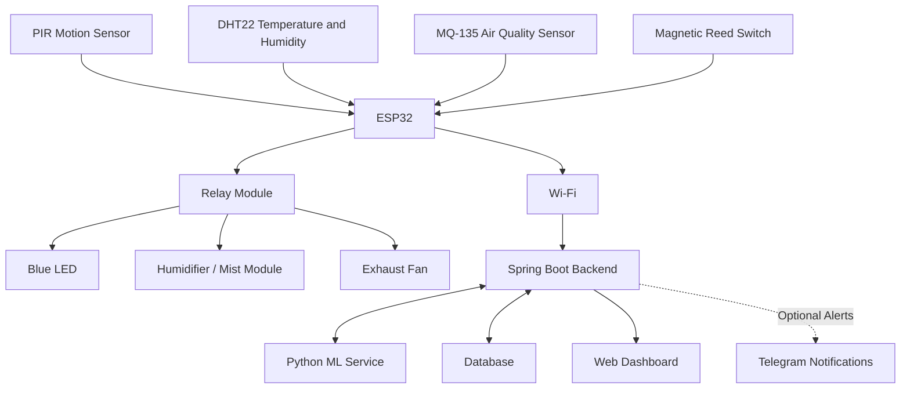

# Automated OT Sterilization System using IoT and AI/ML

## About the Project

This project uses ESP32, IoT, and machine learning to monitor sensor data and predict the duration of different stages in an operation theatre sterilization prototype.

## System Architecture

## Technologies Used

- **Hardware:** ESP32, PIR, DHT22, MQ-135, Magnetic Reed Switch
- **Backend:** Java, Spring Boot, REST API
- **Machine Learning:** Python, Scikit-learn, XGBoost
- **Database:** SQLite / MySQL
- **Communication:** Wi-Fi, JSON
- **Notifications:** Telegram Bot API (optional)

## Machine Learning

The project compares six regression models to predict UV, fog, and fan duration.

- Extra Trees
- Random Forest
- Decision Tree
- Linear Regression
- XGBoost
- Gradient Boosting

Extra Trees achieved the best overall results in the initial model comparison. The models are evaluated using MAE, RMSE, R², and MAPE.

## Workflow

1. ESP32 collects sensor readings.
2. Sensor data is sent to the Spring Boot backend over Wi-Fi.
3. The Python ML service predicts process-stage durations.
4. The database stores relevant data.
5. The dashboard displays sensor readings, device status, and predictions.
6. Optional Telegram notifications report supported system events.

## Note

This is an academic prototype. The blue LED is only a demonstration indicator and does not perform actual sterilization. The system is not intended for clinical use.
